# Guide du relecteur : vérifier les entités avec OpenRefine

Ce guide est fait pour vous si vous n'avez jamais utilisé OpenRefine. Il vous prend par la main, écran par écran. Comptez une demi-journée pour vous installer et faire votre premier lot ; ensuite, un lot de 300 lignes se relit en une à deux heures.

> **Tout ce dont vous avez besoin est dans un seul dossier en ligne :**
> <https://github.com/Grand-Siecle/tei-entity-reconciliation/tree/main/relecteurs>
> Vous y trouverez ce guide, les deux « recettes » à coller dans OpenRefine, un lot d'exemple pour vous entraîner et un mémo des expressions utiles.

## 1. En deux mots

Un programme a lu tous les livres du corpus et a repéré les noms de personnes, de lieux, d'œuvres, de matériaux… Pour chaque nom, il a **proposé** une fiche Wikidata (un identifiant qui commence par Q, par exemple Q868 pour Aristote). Le programme se trompe parfois : il confond des homonymes, il prend un mot courant pour un nom, il rate des graphies anciennes.

Votre travail consiste à **relire ses propositions** dans un tableau, et à dire pour chaque ligne :

| Vous constatez | Vous faites | Le programme comprend |
|---|---|---|
| la proposition est bonne | rien | **ok** |
| la proposition est fausse mais la bonne fiche existe | vous choisissez la bonne fiche | **corriger** |
| la proposition est fausse et il n'y a pas de fiche | vous rejetez la proposition | **corriger** sans fiche |
| ce n'est pas une entité du tout (un mot courant, une erreur de lecture) | vous mettez une **étoile** | **supprimer** |
| vous hésitez | vous mettez un **drapeau** | **doute** |
| deux lignes désignent la même personne | vous leur donnez le même libellé corrigé | **fusionner** |

Vous ne pouvez rien casser : vous travaillez sur une copie, et c'est le responsable technique qui réintègre vos décisions dans la base. Si vous faites une erreur, OpenRefine a un bouton **Défaire**.

Ce qu'il vous faut : un ordinateur Windows ou Mac, une connexion internet, OpenRefine (gratuit, voir ci-dessous), et le fichier de lot que le responsable vous a envoyé, par exemple `person_lot01.csv`.

## 2. Installer OpenRefine (une seule fois)

1. Allez sur <https://openrefine.org/download> et téléchargez la version pour votre système. Sur Windows, prenez la version **« with embedded Java »** (sinon il faudra installer Java à part). Sur Mac, prenez le fichier `.dmg`.
2. Windows : décompressez le dossier où vous voulez (par exemple dans *Documents*), puis double-cliquez sur `openrefine.exe`. Mac : ouvrez le `.dmg` et glissez OpenRefine dans *Applications*, puis lancez-le. Au premier lancement, le Mac peut demander une confirmation dans *Réglages système → Confidentialité et sécurité*.
3. Une fenêtre noire s'ouvre (c'est normal, ne la fermez pas), puis votre navigateur affiche la page d'accueil d'OpenRefine à l'adresse `http://127.0.0.1:3333`. Si le navigateur ne s'ouvre pas tout seul, tapez cette adresse vous-même.
4. Mettez l'interface en français : dans le menu de gauche, cliquez sur **Language settings**, choisissez **Français** et cliquez sur **Change language**. Rechargez la page.

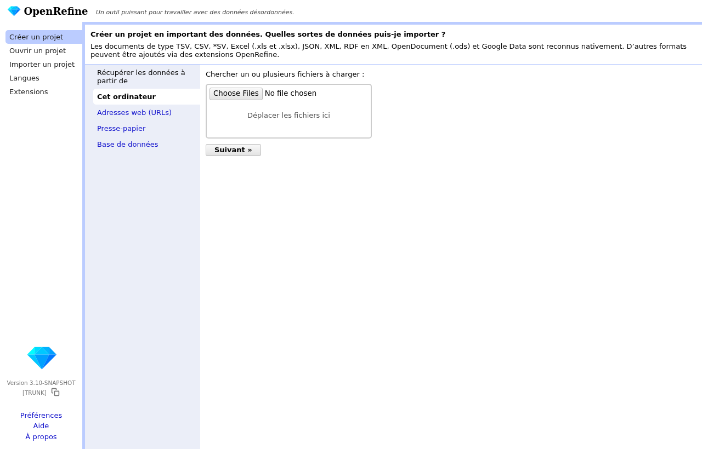

OpenRefine ne travaille jamais sur internet : vos données restent sur votre ordinateur. Il n'utilise internet que pour interroger Wikidata.

## 3. Réglage à faire une seule fois : le service Wikidata en français

OpenRefine connaît Wikidata en anglais. Pour avoir les descriptions en français, on ajoute une fois pour toutes le service en français. Vous n'aurez à le faire que sur votre premier lot.

1. Ouvrez n'importe quel lot (voir le chapitre suivant), puis cliquez sur le petit triangle à gauche de la colonne **qid_propose**, et choisissez **Réconcilier → Démarrer la réconciliation…**
2. Cliquez sur **Ajouter un service standard...**
3. Collez exactement cette adresse : `https://wikidata-reconciliation.wmcloud.org/fr/api` puis cliquez sur **Ajouter un service**.
4. Vous voyez maintenant deux lignes, *Wikidata reconciliation (en)* et *Wikidata reconciliation (fr)*. Cliquez sur **Annuler** : on ne lance pas de réconciliation ici, le réglage est enregistré.

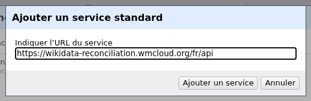

## 4. Ouvrir votre lot

1. Sur la page d'accueil, **Créer un projet** est déjà sélectionné. Cliquez sur **Choose File** (ou **Choisir un fichier**) et prenez votre fichier de lot, par exemple `person_lot01.csv`. Cliquez sur **Suivant »**.

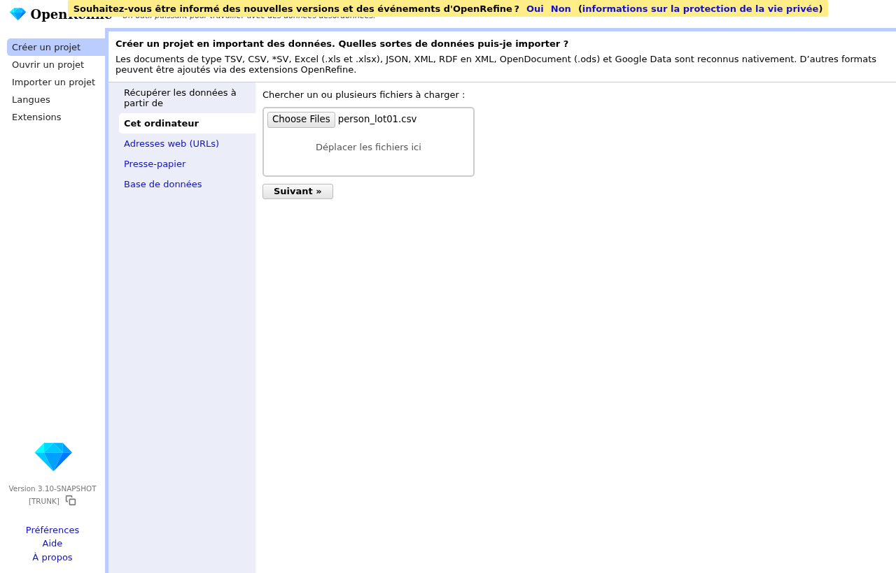

2. OpenRefine vous montre un aperçu. Vérifiez que les colonnes sont bien séparées (une colonne *id*, une colonne *label*, etc.). Si tout est sur une seule colonne, cochez **virgule** dans les options sous le tableau. Ne changez rien d'autre et cliquez sur **Créer un projet »** en haut à droite.

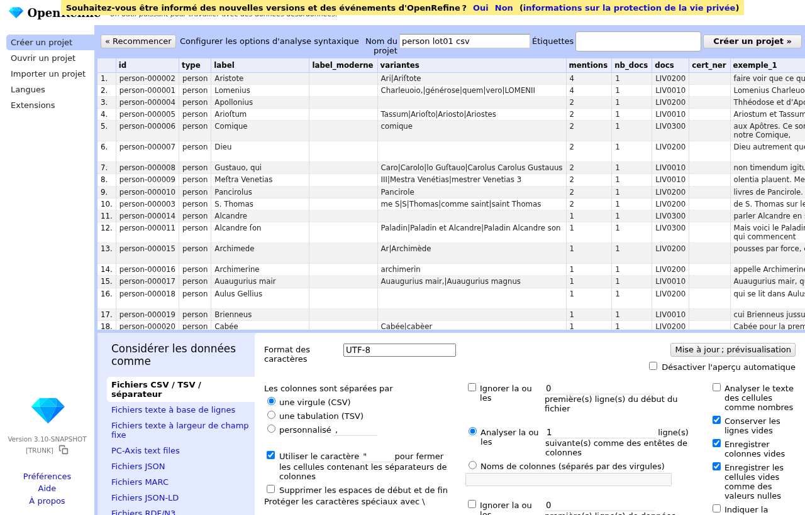

3. Votre lot s'ouvre sous forme de tableau. Chaque ligne est une entité, chaque colonne une information. Le projet est enregistré automatiquement : vous pourrez le rouvrir plus tard par **Ouvrir un projet** sur la page d'accueil, inutile de réimporter le fichier.

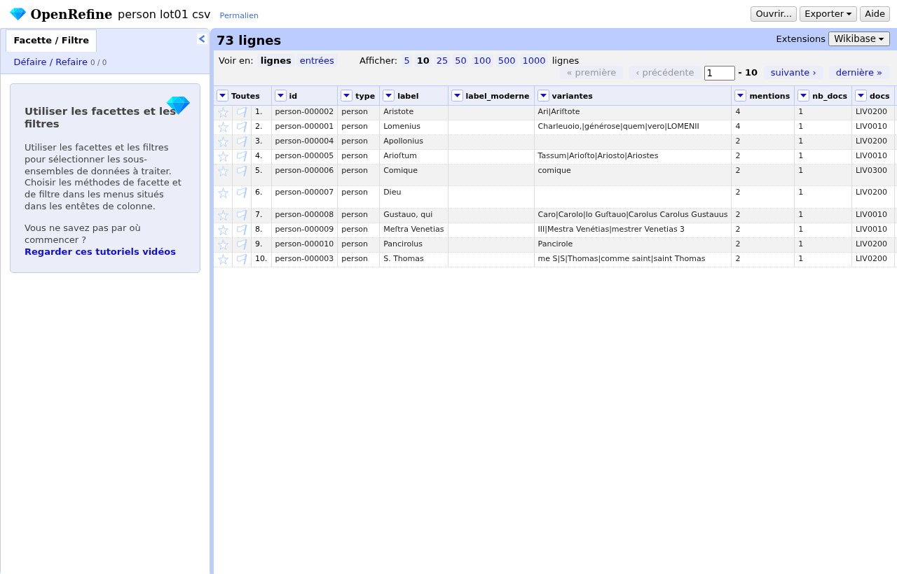

### Les colonnes qui comptent

| Colonne | Ce qu'elle contient |
|---|---|
| **id** | l'identifiant de l'entité (par exemple `person-000432`). Ne le modifiez jamais : c'est la clé qui permet de retrouver vos décisions. |
| **label** | la forme la plus fréquente dans les textes (souvent en graphie ancienne ou en latin) |
| **variantes** | les autres graphies rencontrées, séparées par `|` |
| **mentions** et **nb_docs** | combien de fois, dans combien de livres : plus c'est grand, plus la ligne est importante |
| **exemple_1**, **exemple_2** | deux phrases du corpus où le nom apparaît, pour comprendre de qui ou de quoi on parle |
| **qid_propose**, **label_wikidata**, **description_wikidata** | la fiche Wikidata proposée par le programme, avec son nom et sa description |
| **confiance** | `high` quand le programme est sûr, `medium` quand il a un doute, `low` quand c'est une simple piste |
| **candidats** | d'autres fiches envisagées |
| **local_id**, **isni** | quand la personne est déjà dans le fichier des personnes du projet (auteurs, imprimeurs, libraires) : ces lignes sont presque toujours bonnes |
| **statut** | `nouveau` si vous voyez cette ligne pour la première fois, `modifié` si la proposition a changé depuis votre dernière relecture, `inchangé` sinon |
| **decision**, **qid_corrige**, **fusion_vers**, **label_corrige**, **type_corrige**, **commentaire**, **qui**, **date** | les colonnes où vos décisions vont s'inscrire (le plus souvent automatiquement, voir plus loin) |

Le tableau est large. Pour y voir clair, masquez les colonnes dont vous n'avez pas besoin : cliquez sur le triangle de la colonne **Toutes** (tout à gauche), **Masquer / Afficher → Masquer toutes les colonnes**, puis cliquez sur les petits triangles bleus pour faire réapparaître seulement *id*, *label*, *mentions*, *exemple_1*, *qid_propose*, *label_wikidata*, *description_wikidata* et *confiance*. Rien n'est supprimé : les colonnes masquées restent dans le fichier.

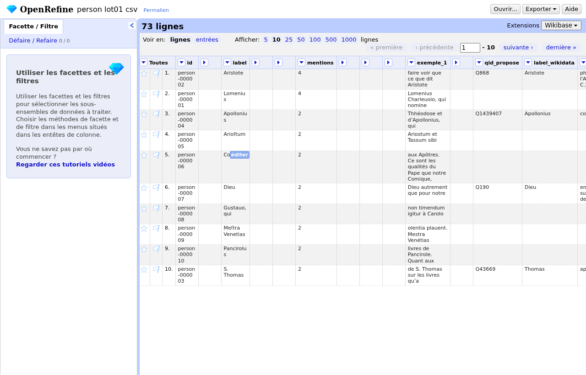

## 5. Lancer la recette de début de lot

Une « recette » est une liste d'opérations qu'OpenRefine exécute pour vous. Nous en avons préparé deux : une pour commencer, une pour finir. Vous les trouverez dans le dossier en ligne, sous `recettes/`.

1. Ouvrez le fichier `recettes/debut_de_lot.json` avec le Bloc-notes (Windows) ou TextEdit (Mac), sélectionnez tout son contenu et copiez-le. Sur la page GitHub, le bouton **Raw** puis *Ctrl+A, Ctrl+C* fait la même chose.
2. Dans OpenRefine, à gauche, cliquez sur l'onglet **Défaire / Refaire**, puis sur **Appliquer…**
3. Collez la recette dans la grande zone de texte et cliquez sur **Suivant »**.

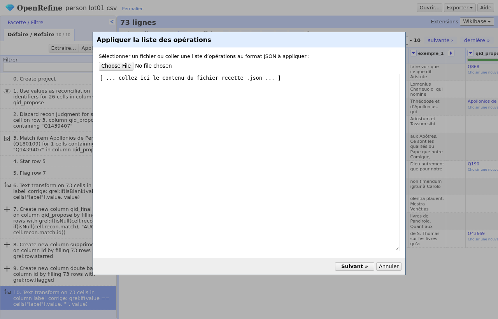

4. OpenRefine vérifie que les colonnes nécessaires existent (*label*, *label_corrige*, *qid_propose*). Elles sont déjà bien reconnues. Cliquez sur **Effectuer les opérations**.

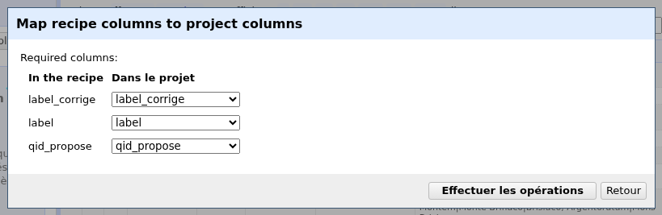

Que vient-il de se passer ? Deux choses :

- la colonne **label_corrige** a été remplie avec une copie du libellé, pour que vous puissiez corriger les graphies et regrouper les doublons (chapitre 7) ;
- les identifiants de la colonne **qid_propose** sont devenus des **liens bleus** : OpenRefine a « réconcilié » chaque proposition avec Wikidata. Quand vous passez la souris sur un lien, une petite fenêtre montre la fiche : nom, description, parfois une image. C'est ce qui va vous permettre de juger vite.

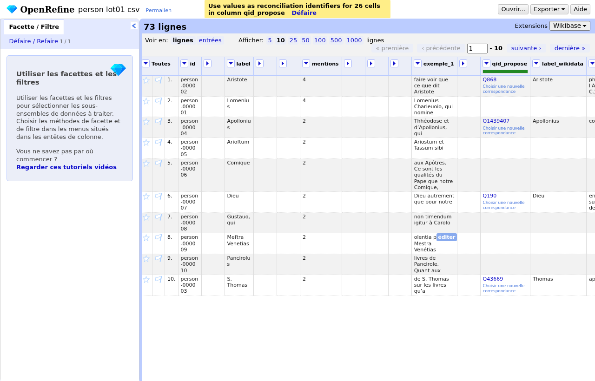

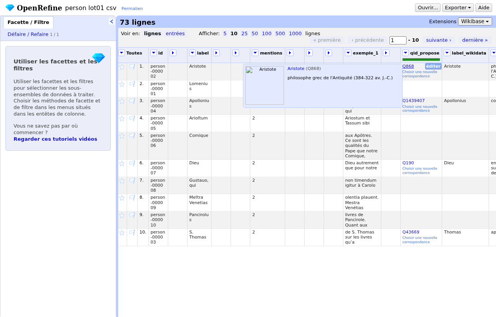

Si l'aperçu ne s'affiche pas, c'est que le service Wikidata en français n'a pas été ajouté (chapitre 3) : ajoutez-le, puis dans **Défaire / Refaire** cliquez sur l'étape *0. Create project* pour revenir au début et relancez la recette.

## 6. Relire, ligne par ligne

Relisez dans l'ordre du tableau : il est trié des entités les plus fréquentes aux plus rares, et les plus fréquentes sont celles qui comptent le plus pour les index. Si vous manquez de temps, arrêtez-vous quand vous atteignez les lignes à une seule mention : elles seront relues plus tard.

Pour chaque ligne, lisez le **label**, les **exemples** et la **description Wikidata**, et posez-vous une seule question : *est-ce bien de cette personne (ce lieu, cette œuvre…) que parle le texte ?*

### 6.1 La proposition est bonne : ne faites rien

Passez à la ligne suivante. L'absence de modification sera comprise comme « ok ».

### 6.2 La proposition est fausse : choisissez la bonne fiche

Exemple réel du lot d'essai : pour *Apollonius*, le programme propose « consul romain en 460 ». Le contexte (*Théodose et Apollonius*, dans un traité de géométrie) montre qu'il s'agit du mathématicien Apollonius de Perge.

1. Dans la cellule, cliquez sur **Choisir une nouvelle correspondance**. La cellule montre les candidats, chacun avec deux petites cases à cocher.

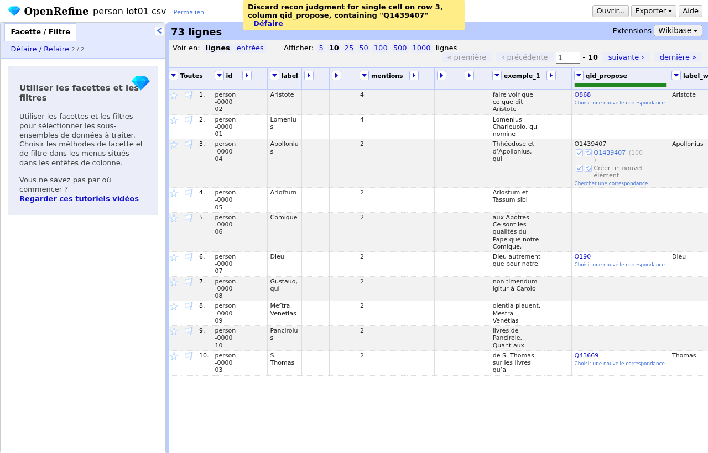

2. Si le bon candidat est dans la liste, cochez sa **première** case (« Apparier cet élément et cette cellule »). Sinon cliquez sur **Chercher une correspondance** : une fenêtre s'ouvre.
3. Cochez **Apparier seulement cette cellule**, puis tapez le nom dans la case de recherche, en français moderne de préférence (*Apollonius de Perge*). Une liste apparaît avec, pour chaque résultat, sa description : c'est elle qui vous permet de choisir.

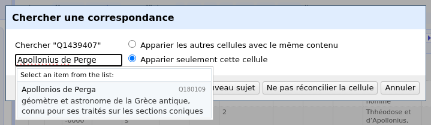

4. Cliquez sur le bon résultat. La cellule affiche maintenant le nom de la fiche choisie.

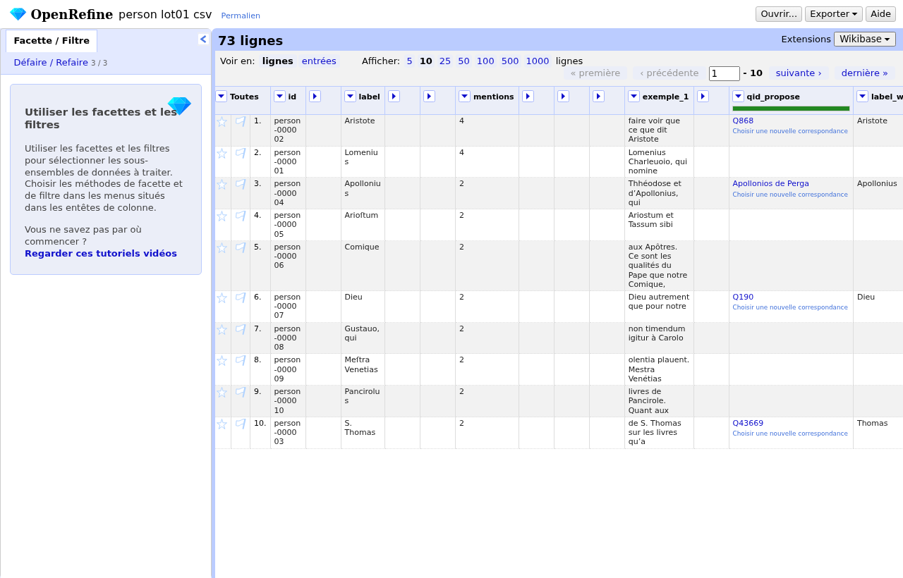

Astuce : avant de valider une personne, regardez les dates dans sa description. Une personne née après 1700 ne peut pas être citée dans un livre du XVIIe siècle. Un lieu doit être en Europe ou dans le monde antique et biblique, sauf si le texte parle explicitement d'ailleurs.

### 6.3 La proposition est fausse et il n'y a pas de bonne fiche : rejetez

Cliquez sur **Choisir une nouvelle correspondance**, puis sur **Chercher une correspondance**, et dans la fenêtre cliquez sur **Ne pas réconcilier la cellule**. Le lien bleu disparaît : le programme comprendra qu'il ne doit inscrire aucune fiche Wikidata pour cette entité. Vous pouvez expliquer pourquoi dans la colonne **commentaire** (double-cliquez dans la cellule, ou cliquez sur **éditer**).

N'utilisez jamais **Créer un nouvel élément** : cela ne crée rien dans Wikidata et le programme ne saurait pas quoi en faire.

### 6.4 Ce n'est pas une entité : mettez une étoile

Le programme prend parfois un mot courant pour un nom (*Comique*, *Pascua*, *bello*), ou un morceau de phrase coupé par une erreur de lecture. Dans ce cas, cliquez sur l'**étoile** tout à gauche de la ligne. La ligne sera supprimée des registres.

### 6.5 Vous hésitez : mettez un drapeau

Cliquez sur le **drapeau** à gauche de la ligne (juste à droite de l'étoile) et, si possible, écrivez votre question dans **commentaire**. Les lignes à drapeau sont discutées ensemble à la réunion suivante. Mieux vaut un drapeau qu'une décision hasardeuse.

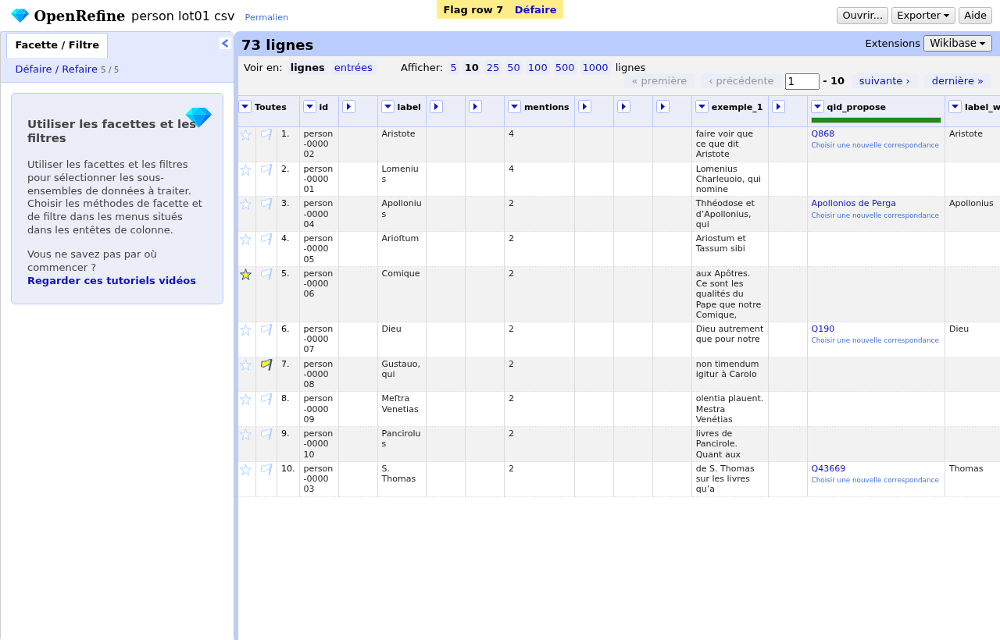

### 6.6 Pour ne voir que ce qui reste à faire

Cliquez sur le triangle de la colonne **qid_propose**, puis **Réconcilier → Facettes → Par avis**. Un petit cadre apparaît à gauche avec le nombre de lignes *matched* (une fiche est choisie) et *(blank)* (aucune fiche). Cliquez sur une valeur pour ne voir que ces lignes, cliquez à nouveau pour tout revoir. Les autres facettes du même menu vous permettent par exemple de ne voir que les lignes dont vous avez changé l'avis.

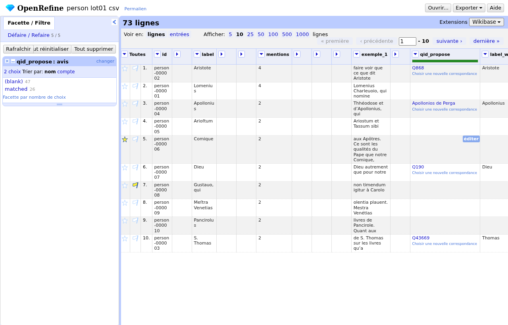

Vous pouvez aussi filtrer sur la colonne **confiance** : triangle de la colonne, **Facette → Facette textuelle**, puis cliquez sur *medium* pour relire d'abord les propositions les moins sûres.

## 7. Regrouper les doublons et corriger les libellés

Le programme regroupe déjà les graphies strictement identiques. Mais *Lomenius*, *Lomenii* et *Loménie* restent trois lignes, et c'est à vous de dire qu'il s'agit d'une seule personne.

**Méthode simple, ligne par ligne.** Dans la colonne **label_corrige** (faites-la réapparaître si vous l'avez masquée), tapez le **même libellé** pour toutes les lignes qui désignent la même entité, par exemple *Loménie de Brienne, Louis-Henri de*. À l'import, les lignes qui portent exactement le même libellé corrigé sont fusionnées en une seule entité, qui garde la fiche Wikidata de la ligne la plus fréquente. Le libellé corrigé devient aussi le libellé affiché dans les index : choisissez la forme française moderne.

**Méthode assistée, pour les grands lots.** Triangle de la colonne **label_corrige**, **Éditer les cellules → Grouper et éditer…** OpenRefine cherche les valeurs qui se ressemblent. Cliquez sur **Groupe**. Pour chaque groupe trouvé, lisez bien les valeurs : s'il s'agit vraiment de la même entité, cochez **Fusionner ?** et vérifiez la *nouvelle valeur* proposée (vous pouvez la modifier). Puis cliquez sur **Fusionner la sélection & fermer**. Si aucun groupe n'apparaît, changez la méthode (**Voisin le plus proche**) ou augmentez le **Rayon**.

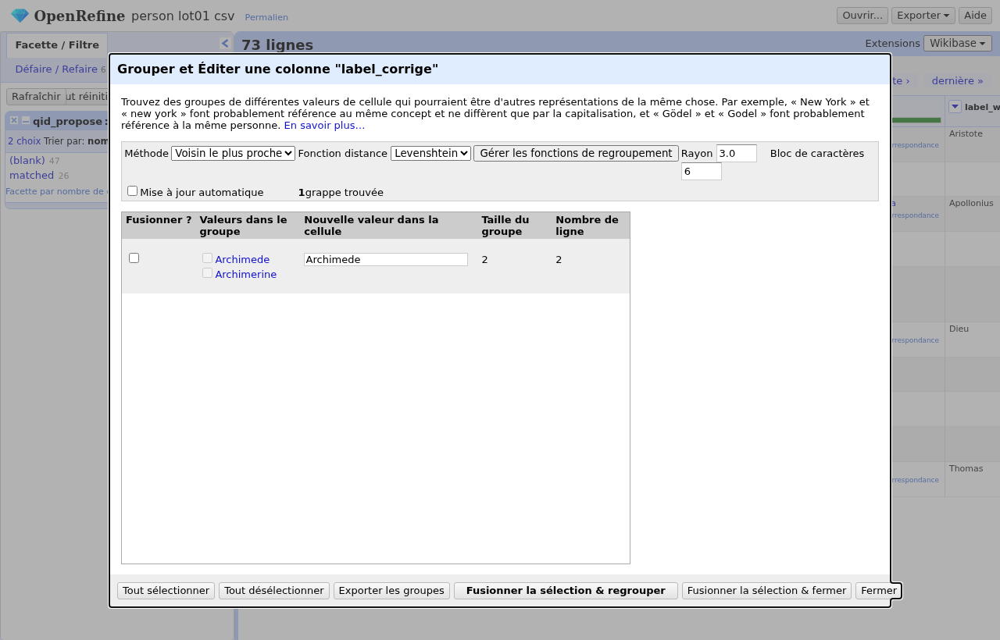

Attention : cet outil propose, il ne décide pas. Dans l'exemple ci-dessus, il rapproche *Archimede* et *Archimerine* parce que les lettres se ressemblent, alors que ce n'est pas la même personne.

**Corriger un libellé sans fusionner.** Tapez simplement la bonne forme dans **label_corrige** de la ligne concernée (par exemple *Descartes, René* à la place de *DESCARTES*). Si une ligne garde un libellé identique à sa colonne *label*, rien ne change.

## 8. Changer le type d'une entité, laisser un commentaire

- Le programme a classé *Athènes* comme personne ? Dans la colonne **type_corrige**, tapez le bon type parmi : `person`, `place`, `org`, `work`, `event`, `artwork`, `material`, `technique`.
- La colonne **commentaire** est libre : notez tout ce qui peut aider (« c'est le père, pas le fils », « cité comme imprimeur », « voir aussi la ligne person-000210 »).
- Vous pouvez écrire votre nom dans **qui** et la date dans **date**, mais le responsable les renseigne de toute façon à l'import.

## 9. Finir le lot et le rendre

1. **Recette de fin de lot.** Comme au chapitre 5 : **Défaire / Refaire → Appliquer…**, collez le contenu de `recettes/fin_de_lot.json`, **Suivant »**, **Effectuer les opérations**. La recette ajoute trois colonnes que le programme lira : **qid_final** (la fiche que vous avez validée, `AUCUN` si vous avez rejeté la proposition, vide si vous n'avez pas touché la ligne), **supprimer** (vos étoiles) et **doute** (vos drapeaux). Elle efface aussi les libellés corrigés que vous n'avez pas modifiés.

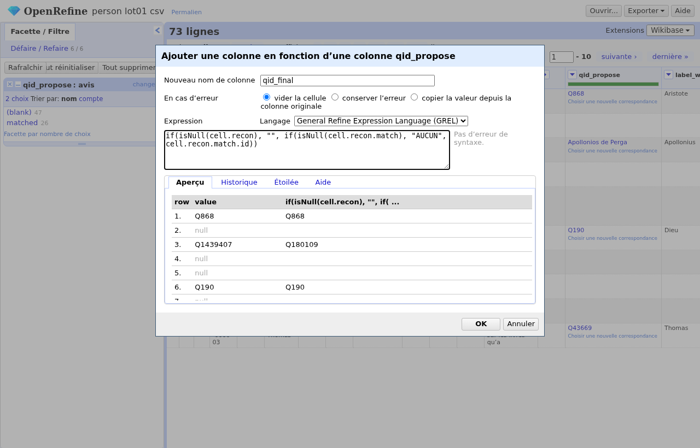

2. **Exporter.** En haut à droite, **Exporter → Valeurs séparées par des virgules**. Le navigateur télécharge un fichier `.csv`.

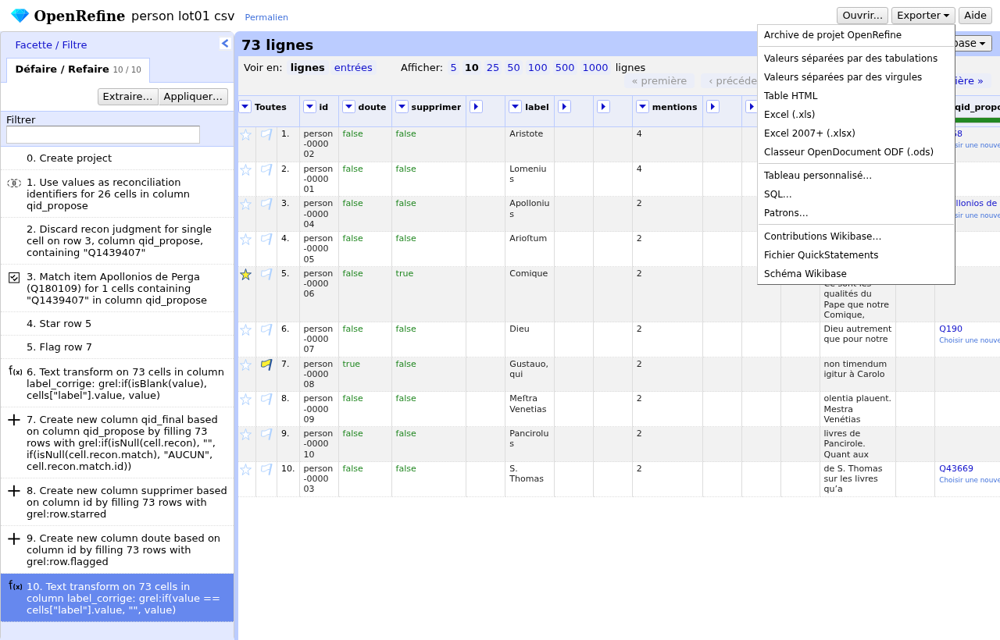

3. **Renommer et déposer.** Renommez le fichier avec le nom du lot et votre prénom, par exemple `person_lot01_relu_marie.csv`, et déposez-le dans le dossier partagé indiqué par le responsable. N'envoyez pas le fichier par courriel, ne le modifiez plus après l'avoir déposé.

4. Vous pouvez fermer OpenRefine (fermez aussi la fenêtre noire). Votre projet reste enregistré sur votre ordinateur : si le responsable vous renvoie le lot avec de nouvelles lignes, importez le nouveau fichier, ne reprenez pas l'ancien projet.

## 10. Les règles de décision

### Personnes

- Les dates et l'activité doivent être compatibles avec le texte : un livre de 1662 ne cite pas quelqu'un né en 1700. Les Anciens, les figures bibliques et les saints sont fréquents : *Dieu*, *Jésus-Christ*, *saint Paul* sont des entités, on garde la fiche.
- Forme latine et forme française d'une même personne : fusionnez, et mettez la forme française moderne dans **label_corrige** (*Loménie de Brienne* plutôt que *Lomenius*).
- Homonymes : la description Wikidata tranche (*peintre flamand* contre *évêque de Tours*). En cas de doute, drapeau.
- Les personnes qui ont un **local_id** (PERS…) sont déjà identifiées par le projet : vérifiez seulement que la fiche Wikidata proposée est la même personne.
- Un nom commun pris pour un nom propre (*Comique*, *le Philosophe*, *Révélation*) : étoile, sauf s'il désigne clairement une personne précise (« le Philosophe » pour Aristote peut être fusionné vers Aristote).

### Lieux

- Privilégiez le lieu d'Europe ou du monde antique et biblique. *Port-Royal* est l'abbaye, pas le port de Jamaïque ; *Rome* est la ville, pas l'empire, sauf si le texte parle de l'État.
- Les lieux antiques ont souvent une fiche distincte de la ville moderne (*Lutèce* / *Paris*) : prenez la fiche qui correspond à l'époque dont parle le texte.
- Régions, pays, fleuves, bâtiments sont des lieux. Les peuples (*les Romains*) sont des organisations ou rien du tout : drapeau si vous hésitez.

### Œuvres, objets, événements

- Une œuvre doit avoir un auteur ou une date plausibles. Les titres latins abrégés sont fréquents : cherchez le titre complet avant de rejeter.
- Un tableau ou une statue précis est un objet (artwork) ; *un tableau* en général n'est pas une entité : étoile.
- Pour les événements, le programme se trompe souvent (il prend *guerre* ou *concile* en général pour un événement précis). Gardez seulement les événements identifiables (*concile de Trente*, *bataille de Lépante*).

### Matériaux et techniques

- Les termes génériques (*matière*, *terre*, *couleur*) ne reçoivent pas de fiche : rejetez la proposition. Les matériaux précis (*marbre*, *bronze*, *vermillon*) et les techniques (*fresque*, *gravure sur cuivre*) en reçoivent une si la fiche Wikidata correspond bien au sens du texte.

## 11. Que faire si…

- **OpenRefine ne s'ouvre pas dans le navigateur.** Tapez `http://127.0.0.1:3333` dans la barre d'adresse. Si rien ne répond, relancez le programme et attendez une vingtaine de secondes.
- **Les accents sont bizarres à l'import.** Dans l'aperçu, choisissez l'encodage **UTF-8** dans les options.
- **Je me suis trompé.** Onglet **Défaire / Refaire** : cliquez sur l'étape précédente pour revenir en arrière. Tout est réversible.
- **L'aperçu Wikidata ne s'affiche pas.** Voyez la fin du chapitre 5.
- **Je ne trouve pas l'entité dans Wikidata.** Essayez une autre graphie, le nom en latin, le prénom seul. Si vraiment rien : rejetez (chapitre 6.3) et expliquez en commentaire.
- **Deux lignes sont la même entité mais dans deux lots différents.** Écrivez dans **fusion_vers** l'identifiant de l'entité à conserver (par exemple `person-000012`), que vous trouverez dans l'autre lot.
- **Le fichier est très gros.** Affichez 50 ou 100 lignes par page (lien **Afficher** au-dessus du tableau) et utilisez les facettes du chapitre 6.6.
- **J'ai fermé sans exporter.** Rouvrez OpenRefine, **Ouvrir un projet**, cliquez sur votre lot : tout est là.

## Annexe A. Expressions utiles

Les filtres se lancent par le triangle d'une colonne, **Filtrer le texte**, ou par **Facette → Facette personnalisée…** avec une expression. Le mémo `memo_expressions.md` du dossier en ligne contient la liste complète, en voici les plus courantes.

| Besoin | Où | Quoi taper |
|---|---|---|
| ne voir que les lignes dont le libellé contient un mot | Filtrer le texte sur *label* | le mot (cochez *expression régulière* pour utiliser `|`, par exemple `Lomen|Lomén`) |
| ne voir que les propositions peu sûres | Facette textuelle sur *confiance* | cliquez sur *medium* ou *low* |
| ne voir que les lignes de plusieurs livres | Facette numérique sur *nb_docs* | glissez le curseur à partir de 2 |
| ne voir que les lignes marquées d'une étoile | menu **Toutes → Facette → Facette par étoile** | |
| voir les lignes où la description parle d'un peintre | Filtrer le texte sur *description_wikidata* | `peintre` |
| mettre en majuscule initiale | Éditer les cellules → Transformations courantes → **En majuscule initiale** | |
| supprimer les espaces en trop | Éditer les cellules → Transformations courantes → **Supprimer les espaces en début et fin** | |

## Annexe B. Liens

- Le dossier du relecteur, avec les recettes et ce guide : <https://github.com/Grand-Siecle/tei-entity-reconciliation/tree/main/relecteurs>
- Télécharger OpenRefine : <https://openrefine.org/download>
- Manuel d'OpenRefine (en anglais) : <https://openrefine.org/docs>
- Leçons en français du Programming Historian : *Nettoyer ses données avec OpenRefine* <https://programminghistorian.org/fr/lecons/nettoyer-ses-donnees-avec-openrefine> et *Enrichir ses données avec le processus de réconciliation d'OpenRefine* <https://programminghistorian.org/fr/lecons/enrichir-donnees-reconciliation-openrefine>
- Chercher dans Wikidata : <https://www.wikidata.org>
- Vocabulaire des matériaux et techniques (Getty AAT) : <https://www.getty.edu/research/tools/vocabularies/aat/>
- Autorités du patrimoine écrit français (Biblissima) : <https://data.biblissima.fr>
